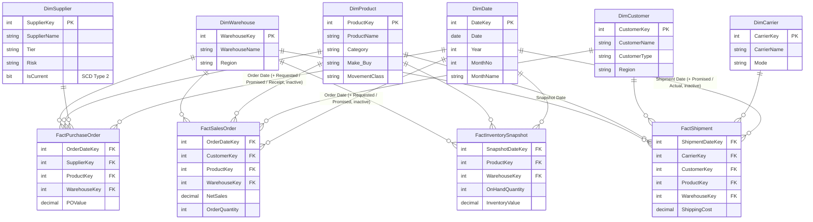

# Manufacturing & Supply Chain Analytics

An end-to-end analytics project for a synthetic **automotive-components manufacturer** — a
**medallion SQL Server data warehouse** feeding a **thin-report Power BI** layer with row-level
security and incremental refresh.

> All data is **synthetic** and fictional — no real company or personal data is used. The source
> data is generated to behave like a *healthy, live operation* (not dummy data) so the reports tell
> a realistic story.
>
> **The Power BI report & model source is intentionally not published** here (only lightweight
> `.pbip` pointer files are included). The reports are showcased via **screenshots** and detailed
> **docs**. See [`LICENSE`](LICENSE) — all rights reserved. Full source available on request.

---

## Architecture

```
┌──────────────────────┐     ┌──────────────────────────────────────────────┐     ┌────────────────────┐
│  OLTP source (sim)   │ ──▶ │          SQL Server Data Warehouse            │ ──▶ │     Power BI        │
│  13 normalized tables│     │  raw  →  stg  →  mart  →  bi (views)  →  etl   │     │  shared model +    │
│  live-like business  │     │          star schema: 6 dim / 4 fact          │     │  3 thin reports    │
│  rules + seasonality │     │          SCD2 · watermark ETL                 │     │  RLS · incremental │
└──────────────────────┘     └──────────────────────────────────────────────┘     └────────────────────┘
```

**Flow:** `OLTP source → raw → stg → mart (star schema) → bi views → Power BI → App`

---

## Repository structure

```
manufacturing-supply-chain-analytics/
├── README.md
├── LICENSE                         # all rights reserved (portfolio viewing only)
├── .gitignore
│
├── sql/                            # build + ETL + analysis + validation (run in order)
│   ├── 01_Manufacturing_Source_Initial_Setup.sql
│   ├── 02_Manufacturing_DW_Setup.sql          # raw/stg/mart/bi/etl schemas, star schema, SCD2
│   ├── 03_ETL_StoredProcedures.sql            # watermark-based incremental ETL (usp_RunFullETL)
│   ├── 04_SQL_Agent_Job_Setup.sql             # scheduled ETL job
│   ├── 05_bi_views.sql                        # bi.* contract layer for Power BI
│   ├── 06_analysis.sql   + FINDINGS.md        # ad-hoc analyst queries
│   └── 07_validation.sql + VALIDATION_REPORT.md   # data-quality + golden-total checks
│
├── powerbi/                        # lightweight .pbip pointer files only (report source withheld)
│   ├── Manufacturing_SemanticModel.pbip
│   ├── 01_Executive_Overview.pbip
│   ├── 02_Inventory_Procurement.pbip
│   └── 03_Fulfillment_Logistics.pbip
│
├── docs/                           # how the BI layer was built
│   ├── MEASURES.md                 # measure catalog
│   ├── REPORT_BLUEPRINT.md         # page-by-page report design
│   ├── POWERQUERY_STANDARDS.md     # query folding standards
│   ├── RLS.md                      # dynamic row-level security design
│   └── DEPLOYMENT_CHECKLIST.md     # Power BI Service deployment (workspace, gateway, refresh, RLS, App)
│
└── screenshots/                    # report previews (how the reports are showcased)
    ├── executive-overview.png
    ├── inventory-procurement.png
    ├── fulfillment-logistics.png
    └── data-model.png
```

---

## Data model

**Warehouse star schema (`mart`):**

| Dimensions (6) | Facts (4) |
|---|---|
| DimDate, DimProduct, DimSupplier (**SCD2**), DimCustomer, DimWarehouse, DimCarrier | FactSalesOrder, FactPurchaseOrder, FactShipment, FactInventorySnapshot |

**Medallion schemas:** `raw` (landing) → `stg` (typed/conformed) → `mart` (star) → `bi` (friendly
views = Power BI contract layer) → `etl` (watermark/control).

---

## Power BI

- **Thin-report architecture:** one **shared semantic model** + **3 thin reports** that live-connect
  to it (7 pages). Change a measure once → every report inherits it.
- **Query folding** against the `bi.*` views (see `docs/POWERQUERY_STANDARDS.md`).
- **Incremental refresh** — rolling 6-year window (RangeStart/RangeEnd).
- **Dynamic Row-Level Security** — `USERPRINCIPALNAME()` + a `SecurityWarehouseAccess` bridge table,
  two roles (see `docs/RLS.md`).

### Headline KPIs (synthetic — from `sql/VALIDATION_REPORT.md`)

| Metric | Value |
|---|---|
| Net Sales | **$679.1M** |
| Fill Rate | **90.6%** |
| Supplier On-Time | **87.4%** |
| Delivery On-Time | **91.1%** |
| Inventory Value | **$42.8M** |

---

## Reports (preview)

### Executive Overview


### Inventory & Procurement


### Fulfillment & Logistics


### Data Model (star schema)



*Simplified star schema — 6 dimensions, 4 facts. `DimDate` is role-played (multiple date roles per
fact; secondary roles are inactive relationships activated via `USERELATIONSHIP`). `DimSupplier` is
SCD Type 2. GitHub renders this diagram automatically.*

---

## Tech stack

- **SQL Server** — medallion data warehouse, T-SQL stored-procedure ETL, SQL Agent scheduling
- **Power BI** — thin reports + shared semantic model, RLS, incremental refresh, query folding
- **Python** — business-rule-driven OLTP data simulator (not included in this public repo)

---

## License

**All rights reserved** — see [`LICENSE`](LICENSE). Published for portfolio viewing only; not licensed
for copying, reuse, or derivative works. The Power BI report/model source is withheld.

---

*Synthetic portfolio project. All names, companies, and data are fictional.*
