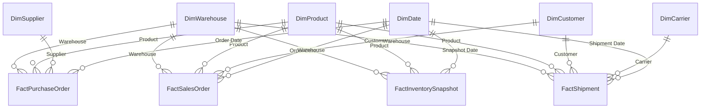

<div align="center">

# Manufacturing & Supply Chain Analytics

### SQL Server • Data Warehousing • ETL • Data Modeling • Power BI • DAX

This project focuses on analyzing **sales, procurement, inventory, and logistics** for a fictional automotive components manufacturer. I used **SQL Server** to build a structured data warehouse, process and organize operational data, and develop a shared **Power BI semantic model** for reporting. The solution brings together key business metrics to analyze sales performance, inventory levels, supplier performance, and order fulfillment through interactive Power BI reports.


</div>

## Project Overview

Manufacturing data is usually spread across several operational activities. A sales order captures customer demand, a purchase order records the material requested from a supplier, an inventory snapshot tells us what is available in a warehouse, and shipment records show how well customer orders are delivered.

Looking at these activities separately gives only part of the picture. For example, a drop in fulfillment performance might be related to a supplier delay, a warehouse stockout, or a logistics issue. This project brings these connected business processes into a common analytical model so they can be reviewed together.

I used **Python** to create a realistic synthetic operational dataset, **SQL Server** to organize and transform it into a dimensional warehouse, and **Power BI** to define business metrics and structure the reporting layer. The design follows a medallion-style SQL workflow, with separate layers for landing, standardization, reporting tables, and reporting views.

| Project Area | Details |
|---|---|
| Industry | Manufacturing / Automotive Components |
| Dataset | Synthetic operational and transactional data |
| Operational source | 13 normalized OLTP tables |
| Data warehouse | Microsoft SQL Server — `Manufacturing_DW` |
| Data processing | T-SQL stored procedures and SQL Server Agent |
| Warehouse model | 6 dimension tables and 4 fact tables |
| Reporting interface | 10 SQL views under the `bi` schema |
| Semantic model | One shared Power BI model |
| Analytical coverage | Executive, Inventory & Procurement, Fulfillment & Logistics |
| Main techniques | Incremental ETL, SCD Type 2, star schema, DAX, RLS, incremental refresh |

All company names, operational records, suppliers, customers, and transactions in this project are **synthetic**.

---

## Business Problem

A manufacturing business needs to balance customer demand, supplier reliability, inventory availability, and delivery performance. These areas are connected, but operational systems do not always make their relationships easy to analyze.

A sales report may show good order value without explaining how much demand was fulfilled. An inventory report may show stock availability without highlighting slow-moving items. Procurement teams may monitor purchase orders without connecting supplier delays to warehouse performance. Similarly, logistics teams may track deliveries without seeing the wider effect on customer service.

The main challenge was to create a consistent data foundation for answering questions across all these areas, without maintaining separate KPI definitions for every report.

## Project Objectives

The project focuses on the following business requirements:

- Monitor sales trends, order quantities, fulfilled demand, backorders, and cancellations.
- Understand inventory value, stock availability, stockouts, excess stock, and slow-moving products.
- Compare supplier performance using on-time receipts, rejected quantities, open purchase orders, and delays.
- Analyze shipments, delivery performance, return rates, and transportation costs.
- Provide consistent calculations across executive and operational reporting views.
- Support historical comparisons, dynamic KPI selection, and product-level investigation.
- Apply warehouse-based security so users can work with the locations relevant to them.
- Keep warehouse processing, Power BI transformations, and business measures clearly separated.

---


## Solution Architecture

The solution moves from synthetic manufacturing data through SQL Server data warehousing and ETL processing into a shared Power BI semantic model, supporting three business-focused reports and Power BI Service delivery.

[](./03%20docs/assets/manufacturing-architecture.svg)


### Responsibilities of Each Layer

| Layer | Purpose |
|---|---|
| **OLTP source** | Holds the related business entities and transactions generated for the manufacturing scenario. |
| **`raw`** | Receives source-aligned tables, keeping the incoming data traceable. |
| **`stg`** | Standardizes types, business keys, and values before dimensional loading. |
| **`mart`** | Stores the fact and dimension tables used for analytics. |
| **`bi`** | Provides reporting-friendly views that act as the interface to Power BI. |
| **`etl`** | Holds ETL control and watermark information; it supports the process rather than acting as another reporting layer. |
| **Power Query** | Connects to reporting views and applies folding-friendly data preparation and refresh filters. |
| **Semantic model** | Centralizes relationships, DAX calculations, parameter tables, metadata, and security. |
| **Thin reports** | Present the shared measures through business-focused pages and interactions. |

I kept the heavier data preparation in SQL Server and used the semantic model mainly for calculations that depend on filter context, such as revenue comparisons, fill rates, supplier performance, and dynamic KPI analysis.

---

## Source Data and Business Domains

The source simulates the day-to-day records of an automotive-components manufacturer. The dataset contains **13 normalized operational tables** with related master and transactional data.

| Business Domain | Information Captured | Reporting Use |
|---|---|---|
| Products | Product attributes, categories, sourcing, costs, and prices | Product mix and stock analysis |
| Customers | Customer profiles, types, and regions | Customer and sales analysis |
| Suppliers | Supplier attributes and sourcing information | Supplier performance and risk |
| Warehouses | Warehouse identifiers and locations | Inventory and warehouse reporting |
| Sales orders | Customer orders, ordered quantities, and fulfillment | Sales demand and service performance |
| Purchase orders | Supplier orders, receipts, and rejections | Procurement and supplier analysis |
| Shipments | Shipped items, delivery dates, carriers, and costs | Delivery and logistics analysis |
| Inventory snapshots | Stock positions for products at warehouses over time | Availability, stockouts, and stock value |

The operational records include the relationships needed to analyze these areas together, rather than generating unrelated sample rows for individual dashboards.

---

## SQL Server Data Warehouse

I organized the SQL Server warehouse into schemas that follow the processing stages. This makes it easier to understand where data enters the system, where standardization happens, and which tables are intended for reporting.

### 1. Raw Layer

The `raw` schema receives the source-aligned records from the operational database. It provides the starting point for warehouse processing and keeps the original business entities available for tracing issues back to their source.

### 2. Staging Layer

The `stg` schema prepares the incoming records for dimensional loading. The work includes aligning data types and keys, standardizing values, and preparing the data for consistent relationships between facts and dimensions.

### 3. Mart Layer

The `mart` schema contains the reporting model: **six dimension tables and four fact tables**. The data is organized at defined analytical grains so order-level, line-level, and inventory snapshot calculations remain consistent.

### 4. Business Intelligence Views

The `bi` schema provides **10 reporting views**, one for each fact and dimension table. Power BI connects to these views instead of depending directly on the physical warehouse tables. This gives the reporting layer a stable interface and keeps SQL-specific preparation separate from Power BI calculations.

### 5. Incremental ETL and Scheduling

The warehouse workflow uses T-SQL stored procedures and watermark-based processing to identify new or changed records. The stored procedure **`usp_RunFullETL`** provides a central entry point for the ETL sequence, while SQL Server Agent is used for scheduling the warehouse process.

The `etl` schema supports this workflow with execution and watermark controls. Separating the ETL logic from the reporting layer keeps data processing easier to maintain and validate.

### 6. Supplier History — SCD Type 2

For supplier attributes that change over time, `DimSupplier` follows a **Slowly Changing Dimension Type 2** approach. It retains historical supplier versions using effective dates and a current-record indicator, rather than simply replacing the previous value. This helps preserve the supplier context associated with past purchase transactions.

---

## Dimensional Data Model

The warehouse uses a **star-schema approach**, with descriptive dimensions connected to transactional facts. Each fact has a defined grain, which helps ensure that calculations behave correctly when users filter by time, product, customer, warehouse, supplier, or carrier.

### Dimension Tables

| Dimension | Purpose |
|---|---|
| `DimDate` | Calendar attributes, chronological sorting, and time analysis |
| `DimProduct` | Product, category, sourcing, and movement attributes |
| `DimSupplier` | Supplier details and historical attribute tracking through SCD Type 2 |
| `DimCustomer` | Customer characteristics and segmentation |
| `DimWarehouse` | Warehouse details, regions, and security scope |
| `DimCarrier` | Carrier and transport-mode information |

### Fact Tables

| Fact Table | Analytical Grain | Main Use |
|---|---|---|
| `FactSalesOrder` | One sales order line | Net Sales, quantities, fulfillment, and backorders |
| `FactPurchaseOrder` | One purchase order line | PO value, receipts, open quantities, and supplier timeliness |
| `FactShipment` | One shipment line | Shipment quantities, delivery performance, returns, and freight costs |
| `FactInventorySnapshot` | One product × warehouse × snapshot date | On-hand stock, inventory value, stockouts, and stock cover |

### Model Relationships



The model follows a few important principles:

- Dimension tables filter the corresponding fact tables through one-to-many relationships.
- Filtering is kept single-direction wherever possible to avoid ambiguous relationship paths.
- Technical identifiers are hidden from report users where they do not add reporting value.
- `DimDate` is used as the shared calendar table, with alternate date relationships where business processes require them.
- Inventory measures use the **latest relevant snapshot** rather than adding balances from different dates together.

### Multiple Date Roles

Sales, purchasing, and logistics need different interpretations of time. A sales record may have order, requested, and promised dates, while a shipment may have shipment, promised delivery, and actual delivery dates.

The model keeps the normal reporting relationship active and uses additional inactive relationships with `USERELATIONSHIP()` in date-specific measures. This makes it possible to compare performance using different business dates without duplicating the calendar table for every scenario.

---

## Power Query and Data Refresh

The shared Power BI model connects to the SQL Server `bi` views through Power Query. The connection is parameterized with **`ServerName`** and **`DatabaseName`**, so the SQL Server connection can be managed without rewriting each query.

### Power Query Preparation

The transformation steps focus on keeping the dataset reporting-ready while allowing work to be pushed back to SQL Server through **query folding**.

Examples include:

- Applying the refresh-window filter early on fact queries.
- Converting currency fields to fixed-decimal types.
- Removing a row-level fill-rate column in favor of a DAX measure that aggregates correctly.
- Converting inventory movement timestamps to date values where time is not needed.
- Aligning supplier effective dates and product cost/price types.
- Creating a chronological sort key for year-month labels.

### Incremental Refresh Design

The fact tables use `RangeStart` and `RangeEnd` parameters, with a helper function to convert the date-time window to the integer date-key format (`yyyymmdd`) used by the warehouse.

| Fact Table | Historical Window | Incremental Refresh Window |
|---|---|---|
| `FactSalesOrder` | 6 years | 6 months |
| `FactPurchaseOrder` | 6 years | 6 months |
| `FactShipment` | 6 years | 3 months |
| `FactInventorySnapshot` | 6 years | 3 months |

This arrangement is intended to avoid processing the complete historical dataset for every refresh while retaining the required reporting history. The refresh windows can be adjusted if backdated or late-arriving changes need to be picked up over a longer period.

---

## Power BI Semantic Model

I organized the Power BI layer around **one shared semantic model and three thin-report areas**. The semantic model holds the reusable business logic, so the same KPI definition can be used in multiple reports without recreating calculations or relationships.

The shared model is responsible for:

- Relationships between the warehouse facts and dimensions.
- A central `_Measures` table for DAX calculations.
- Time-intelligence calculations and alternate date roles.
- KPI selection, period comparison, and dynamic analysis parameters.
- Friendly field names, formats, sort order, and hidden technical columns.
- Warehouse-level dynamic row-level security.
- Refresh policies for the larger fact tables.

This separation keeps the semantic model focused on business definitions and allows report pages to focus on presenting those definitions clearly.

---

## DAX Measures and Folder Structure

The Power BI semantic model contains **222 documented DAX measures**, including **9 hidden helper measures**. All measures are kept in the dedicated **`_Measures`** table and organized into **40 display folders**.

Rather than listing every individual measure in the README, the folder structure shows how the calculations are grouped and which parts of the business they support. Measures are built in layers: base calculations provide quantities and values, while comparison, status, ranking, and dynamic measures reuse them for more advanced analysis.

### Measure Folder Organization

| Measure Group | Display Folders | Analytical Purpose |
|---|---|---|
| **Sales** | Counts, Date Roles, Exceptions, Quantity, Ratios, Time Intelligence, Value | Revenue, orders, backorders, fulfillment, and sales trends |
| **Procurement** | Counts, Date Roles, Exceptions, Quantity, Ratios, Time Intelligence, Value | Purchase orders, supplier delivery, receipt quality, and open commitments |
| **Inventory** | Counts, Exceptions, Quantity, Ratios, Snapshot, Value | Stock availability, inventory valuation, stockouts, and aging |
| **Logistics** | Counts, Date Roles, Exceptions, Quantity, Ratios, Time Intelligence, Value | Shipments, delivery timeliness, returns, and shipping costs |
| **KPI** | Comparison, Status, Targets | Business targets, performance comparisons, and KPI indicators |
| **Dynamic** | KPI Selection, Period Selection, Time Basis, Titles | User-driven analysis, dynamic KPIs, and context-aware text |
| **Other Analytical Tools** | Conditional Formatting, Drillthrough, Reference Lines, Scenario, Share and Rank, Tooltips | Visual context, rankings, scenarios, and deeper analysis |

*In the model, these are single-level display folders such as `Sales - Value`, `Inventory - Snapshot`, `Dynamic - KPI Selection`, and `KPI - Status`; the table groups them by subject for readability.*

### How the Measures Are Used

**Core business measures** cover metrics such as Net Sales, Order Quantity, PO Value, Inventory Value, Shipped Quantity, and Shipping Cost. These are reused as the foundation for many other calculations.

**Ratio and performance measures** calculate Fill Rate, Supplier On-Time, Delivery On-Time, Stockout Rate, Return Rate, Rejection Rate, and other business indicators using the appropriate totals and denominators.

**Time-intelligence measures** support MTD, QTD, YTD, last-twelve-month, and year-over-year comparisons. The model also includes measures for alternate operational dates, such as promised or actual delivery dates.

**Dynamic measures** work with selector tables so a user can switch KPIs, time periods, or comparison methods. Other measure groups support target indicators, conditional formatting, Top N analysis, product drillthrough, tooltips, and scenario calculations.

### Important Calculation Design Choices

- **Order counts** use distinct business orders rather than counting order-item rows.
- **Rates and percentages** are calculated from aggregated numerators and denominators instead of averaging individual line percentages.
- **Inventory Value** is taken from the applicable snapshot, since stock balances should not be summed across reporting dates.
- **Selected-period analysis** is anchored to the latest available sales date in the synthetic dataset.
- **Measure branching** helps keep shared KPI logic consistent across reports.

---

## Business KPIs

The solution covers financial, operational, supplier, and service-performance metrics.

| Business Area | Key Metrics | What They Explain |
|---|---|---|
| **Sales** | Net Sales, Gross Sales, Average Order Value, Sales Growth | Revenue contribution and demand trends |
| **Fulfillment** | Fill Rate, Fulfilled Quantity, Backorder Quantity | How successfully ordered demand is served |
| **Inventory** | Inventory Value, Available Quantity, Stockout Rate, Stock Cover | Stock availability and working-capital exposure |
| **Procurement** | PO Value, Open PO Value, Supplier On-Time, Rejection Rate | Supplier reliability and purchasing performance |
| **Logistics** | Delivery On-Time, Average Delivery Delay, Shipping Cost per Unit, Return Rate | Delivery service and transportation efficiency |
| **Management** | Target Variance, KPI Status, Contribution %, Top N Rankings | Where performance needs attention |

### Reference Performance Snapshot

The project’s synthetic validation baseline includes the following results:

| Metric | Reference Value |
|---|---:|
| Net Sales | **$679.1M** |
| Fill Rate | **90.6%** |
| Delivery On-Time | **91.1%** |
| Inventory Value | **$42.8M** |

These figures summarize the example operational dataset rather than a real manufacturer's financial or supply-chain performance.

---

## Power BI Report Design

The reporting experience is organized into three business-focused thin reports, all based on the same semantic model. The layouts and interactions are designed around how different business users would review the data.

### 1. Executive Overview

The Executive Overview is structured as a high-level performance summary. Its focus is to make the main business indicators easy to review before going into more detailed analysis.

- KPI cards for Net Sales, Fill Rate, Delivery On-Time, Supplier On-Time, Return Rate, and Inventory Value.
- Period and year-over-year comparisons alongside headline figures.
- Sales and operational performance trends with selectable metrics.
- Target indicators and exception summaries for warehouse or carrier performance.
- Dynamic titles and contextual tooltips to explain the selected view.


[](https://app.powerbi.com/view?r=eyJrIjoiMGFmMGViNmQtYjlkMC00MjI4LTgxMTItOTNhMmRjYTM0YTUyIiwidCI6ImQ4ZTFiMDVlLTcwYWEtNGVmNy1iODc4LTQ2NmI2ODhmOTUyZiJ9)

### 2. Inventory & Procurement

This report focuses on stock health and supplier performance. Its design separates **Inventory** and **Procurement** views, with the ability to move into product-level analysis.

**Inventory analysis** covers stock value, stockouts, slow-moving and dead stock, available quantities, stock cover, warehouse comparison, and product-level stock positions.

**Procurement analysis** covers purchase order value, open orders, supplier timeliness, average delays, rejected quantities, supplier risk, and supplier contribution.

The **Product 360** drillthrough brings together sales, stock, fulfillment, and sourcing measures for a selected product.

[](https://app.powerbi.com/view?r=eyJrIjoiMGFmMGViNmQtYjlkMC00MjI4LTgxMTItOTNhMmRjYTM0YTUyIiwidCI6ImQ4ZTFiMDVlLTcwYWEtNGVmNy1iODc4LTQ2NmI2ODhmOTUyZiJ9)

### 3. Fulfillment & Logistics

This report brings customer-order fulfillment and shipment delivery into one analysis area.

- Fulfillment KPIs for sales, filled orders, backorders, and order value.
- Logistics KPIs for on-time delivery, delivery delays, freight costs, and returns.
- Comparisons by customer type, product category, carrier, transport mode, and region.
- Top N analysis to identify important customers and carriers.
- Scenario analysis using price and volume assumptions.
- Alternate date-based views for order, shipment, promised, and actual delivery performance.

[](https://app.powerbi.com/view?r=eyJrIjoiMGFmMGViNmQtYjlkMC00MjI4LTgxMTItOTNhMmRjYTM0YTUyIiwidCI6ImQ4ZTFiMDVlLTcwYWEtNGVmNy1iODc4LTQ2NmI2ODhmOTUyZiJ9)

### Interactive Reporting Features

The semantic model provides the logic for dynamic KPI selection, time-period comparisons, what-if parameters, field parameters, Top N ranking, and dynamic titles. The report layouts also specify bookmarks, tooltips, drillthrough, slicers, reference lines, and reset-style navigation to support business exploration without overcrowding the pages.

---

## Row-Level Security

The project uses **dynamic warehouse-level row-level security** in the shared semantic model. This allows one model to provide different warehouse scopes to different users.

A table named `SecurityWarehouseAccess` maps each user's email address to one or more warehouse IDs. The model uses `USERPRINCIPALNAME()` to identify the signed-in user and applies the corresponding filter to `DimWarehouse`. The existing dimension-to-fact relationships then restrict the associated sales, purchasing, shipment, and inventory rows.

| Model Role | Access |
|---|---|
| **Warehouse Manager** | Sees the warehouses assigned to the signed-in user |
| **All Warehouses** | Has access across all warehouse locations |

This structure avoids maintaining separate reports for each manager or region. The security rules are defined in the shared model, so report experiences connected to that model use the same underlying authorization design.

---

## Data Validation and Performance

I treated validation as part of the warehouse and model design, rather than only checking whether dashboard visuals display values.

### SQL and Data Checks

- Comparing row counts through the warehouse stages.
- Checking null keys, duplicate business keys, and orphan relationships.
- Confirming fact-table grain and dimension-key integrity.
- Validating sales totals, purchasing quantities, shipment counts, and inventory snapshots.
- Reconciling headline KPIs against independent T-SQL calculations.
- Checking date ranges and results across the different business domains.

### Power BI Modeling and Performance

- Keeping Power Query transformations compatible with query folding where practical.
- Using a dimensional model with controlled relationship direction.
- Keeping technical columns hidden and avoiding unnecessary implicit aggregation.
- Reusing central DAX measures rather than duplicating calculations across visuals.
- Maintaining correct time-intelligence and inventory snapshot logic.
- Using fact-specific incremental refresh policies.
- Checking slicer behavior, KPI comparisons, and warehouse security filters.

The most important modeling distinction is between **transactional measures**, which can generally be accumulated over a date range, and **inventory balances**, which describe a specific point in time.

---

## End-to-End Project Workflow

The overall workflow follows the business data from its source into the reporting model.

| Step | Workstream | Main Work |
|---|---|---|
| **01** | Source data | Generate connected, synthetic manufacturing transactions and master data. |
| **02** | Source setup | Prepare the source database and operational table structures. |
| **03** | Warehouse setup | Create the `raw`, `stg`, `mart`, `bi`, and `etl` schemas. |
| **04** | Data processing | Load and standardize source records using the SQL ETL procedures. |
| **05** | Dimensional modeling | Build six dimensions and four facts, including supplier Type 2 history. |
| **06** | Incremental processing | Use watermarks and SQL Agent for repeatable warehouse execution. |
| **07** | Reporting interface | Expose dimension and fact data through the `bi` views. |
| **08** | Power Query | Connect to the views and apply folding-friendly transformations and refresh filters. |
| **09** | Semantic modeling | Configure relationships, date roles, measures, parameters, formats, and RLS. |
| **10** | Report design | Organize the executive, inventory/procurement, and fulfillment/logistics views. |
| **11** | Validation | Compare SQL outputs with semantic-model measures and check filter behavior. |
| **12** | Source control | Use Git and Azure DevOps to track changes to the SQL, Power BI, and documentation work. |
| **13** | Service delivery | Use the model-first publishing, gateway, refresh, RLS, and App deployment workflow. |

For a local SQL Server environment, the Power BI Service delivery design uses an **on-premises data gateway** and schedules the model refresh after the upstream data and warehouse ETL have completed.

---

## Source Control — Git and Azure DevOps

I use **Git** and **Azure DevOps** to manage changes during development and keep the project work organized. Version control is useful in this project because the SQL warehouse, Power BI model, and documentation are developed together, and a change in one part of the solution can affect another.

Git helps me track updates to SQL scripts, reporting definitions, and documentation, while **Azure DevOps Repos** provides a central place to manage the development history. I use **GitHub** to present the project, its structure, and the implementation approach as part of my portfolio.

### Source Control Workflow

```text
SQL scripts / Power BI project work / documentation
                     ↓
             Local Git changes
                     ↓
           Review and commit
                     ↓
              Azure DevOps
                     ↓
          GitHub project showcase
```

The source-control workflow helps me:

- Track changes to SQL scripts, Power BI project definitions, and technical documentation.
- Keep the project documentation aligned with model and reporting changes.
- Review earlier versions when modifying transformations, business measures, or report definitions.
- Maintain a clear development history while sharing a readable project overview on GitHub.

Source control is separate from executing the SQL Agent jobs or refreshing the Power BI semantic model. Those operational activities are handled through the database and Power BI environments rather than Git commits.

---

## Project Structure

The project files are organized around SQL development, Power BI work, and supporting technical documentation.

```text
manufacturing-supply-chain-analytics/
│
├── README.md
├── LICENSE
├── .gitignore
│
├── 01_sql/
│   ├── 01_Manufacturing_Source_Initial_Setup.sql
│   ├── 02_Manufacturing_DW_Setup.sql
│   ├── 03_ETL_StoredProcedures.sql
│   ├── 04_SQL_Agent_Job_Setup.sql
│   ├── 05_bi_views.sql
│   ├── 06_analysis.sql
│   ├── FINDINGS.md
│   ├── 07_validation.sql
│   └── VALIDATION_REPORT.md
│
├── 02_powerbi/
│   ├── Manufacturing_SemanticModel.pbip
│   ├── 01_Executive_Overview.pbip
│   ├── 02_Inventory_Procurement.pbip
│   └── 03_Fulfillment_Logistics.pbip
│
├── 03_docs/
│   ├── MEASURES.md
│   ├── REPORT_BLUEPRINT.md
│   ├── POWERQUERY_STANDARDS.md
│   ├── RLS.md
│   └── DEPLOYMENT_CHECKLIST.md
```

The main SQL scripts are numbered in their execution sequence. Supporting files contain the analysis and validation results, while the documentation folder captures model definitions, measure organization, Power Query standards, report design, security, and deployment guidance.

The repository brings together SQL scripts, Power BI project references, and technical documentation. The report sections above also link directly to the Power BI reporting experience.

---

## Technology Stack

| Tool / Technology | Role |
|---|---|
| **Python** | Synthetic operational data generation |
| **Microsoft SQL Server** | Relational source and analytical data warehouse |
| **T-SQL** | Schema design, ETL procedures, reporting views, and validation |
| **SQL Server Agent** | Warehouse ETL scheduling |
| **SQL Server Management Studio** | SQL development, investigation, and validation |
| **Power Query (M)** | SQL view ingestion, type preparation, and query folding |
| **Power BI Desktop** | Semantic modeling and report authoring |
| **DAX** | KPIs, comparisons, dynamic analysis, rankings, and time intelligence |
| **Power BI Service** | Model refresh, gateway connection, security, and report distribution workflow |
| **Git** | Version tracking for development changes |
| **Azure DevOps Repos** | Central Git-based source control for project development |
| **GitHub** | Public project presentation and portfolio documentation |

---

## Project Summary

This project brings together the core data-engineering and business-intelligence work needed to analyze a connected manufacturing operation. Starting from a synthetic OLTP system, I used SQL Server to organize the data into a structured warehouse, built a star schema around sales, procurement, shipments, and inventory, and used a shared Power BI semantic model to support reusable business calculations.

The work covers several important practical areas: **incremental data processing, SCD Type 2 history, fact and dimension modeling, query folding, incremental refresh, DAX measure organization, dynamic analysis, row-level security, SQL-based validation, and Git/Azure DevOps source control**.

What makes the solution useful is the connection between the business areas. Instead of reviewing sales, stock, suppliers, and deliveries as independent reports, the model provides a consistent foundation for understanding how these activities influence overall supply-chain performance.

---

## License and Connect

**Copyright © 2026 Bhushan. All rights reserved.** This repository is shared for portfolio viewing and technical evaluation. Refer to [LICENSE](LICENSE) for usage and distribution terms.


For feedback, professional opportunities, or collaboration, feel free to connect with me on LinkedIn.

[](https://www.linkedin.com/in/bhushangawali148/)

